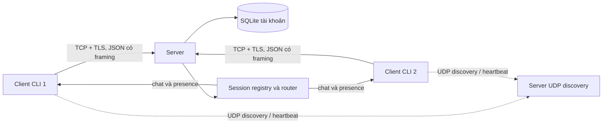

# Kiến trúc ứng dụng

## Mục tiêu và phạm vi

Đây là kiến trúc **client–server**: các client không tự kết nối trực tiếp với nhau. Server đăng nhập người dùng, quản lý phiên online và chuyển tiếp tin nhắn. Đặc tả gốc yêu cầu raw sockets, xử lý nhiều client, chat và truyền file tin cậy. Nhóm chọn Python, CLI, TLS cho TCP và UDP discovery/heartbeat. Các lựa chọn này là cách nhóm đáp ứng đề, không phải mọi lựa chọn đều bị đề chỉ định.

## Sơ đồ thành phần

## Các thành phần

- **Client CLI (`src/collab/client/`):** mở TCP/TLS, xác minh chứng chỉ server, gửi request có `request_id`, nhận response/event ở luồng đọc nền, hiển thị lệnh và trạng thái.
- **Thư viện dùng chung (`src/collab/common/`):** định nghĩa message JSON, framing TCP, schema UDP, TLS context và hàm dẫn xuất mật khẩu.
- **Server TCP (`src/collab/server/server.py`):** accept socket, tạo worker thread cho mỗi kết nối, thực hiện TLS và xử lý handshake, auth, session, chat.
- **Session registry/router:** gắn username với socket, địa chỉ IP/cổng mà server quan sát được; định tuyến broadcast/direct và thông báo online/offline.
- **Server UDP (`src/collab/server/discovery.py`):** trả địa chỉ TCP khi client hỏi và phản hồi heartbeat. Nó không xác thực tài khoản, không tạo phiên TCP.
- **SQLite:** lưu username, salt và giá trị dẫn xuất `scrypt`; không lưu password nguyên văn.
- **Transfer:** có thư mục module nhưng chưa được server kết nối. File chưa truyền đầu-cuối; server hiện trả `server_busy` cho yêu cầu file.

## Hai luồng dữ liệu cần phân biệt

1. **Kênh ứng dụng:** client kết nối TCP → bắt tay TLS → gửi `hello` → nhận `welcome` → đăng nhập/chat/logout. TCP bảo toàn thứ tự byte nhưng không giữ ranh giới message, do đó payload JSON được đóng khung bằng header độ dài.
2. **Kênh dò tìm:** client gửi UDP `discover` → server trả `server_announcement` → client dùng địa chỉ đó để bắt đầu kết nối TCP/TLS riêng. UDP heartbeat cũng độc lập với phiên đăng nhập.

## Độ tin cậy và giới hạn hiện tại

- Server dùng worker thread và giới hạn cấu hình mặc định 100 kết nối, nhưng repository chưa có kết quả chứng minh tải 10–20 client.
- UDP có thể mất datagram, bị firewall chặn hoặc bị giả mạo. Announcement chỉ là gợi ý địa chỉ; xác minh TLS mới là bước kiểm tra danh tính server.
- TCP `ping/pong` giữ phiên hoạt động; UDP heartbeat không cập nhật session registry.
- Mất kết nối sẽ dẫn đến xóa session và phát `presence_offline`; chưa có hàng đợi tin nhắn offline.
- Truyền file, checksum/chunk đầu-cuối và tiến độ file chưa hoạt động do server transfer handler chưa tích hợp.
