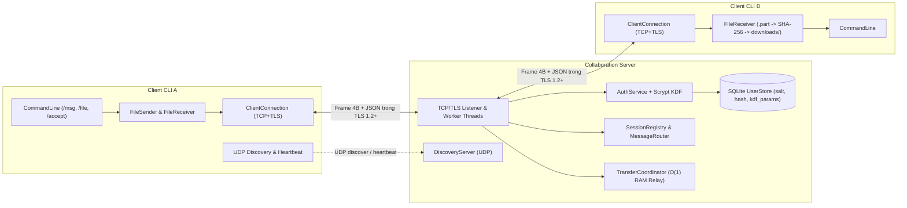

# Kiến trúc ứng dụng

## 1. Mục tiêu và phạm vi

Ứng dụng được xây dựng theo kiến trúc **Client–Server phân tán** bằng Python và raw sockets (`socket` + `ssl` chuẩn, không dùng HTTP framework hay WebSocket). Các client không kết nối ngang hàng trực tiếp với nhau: máy chủ đảm nhận xác thực tài khoản, quản lý phiên trực tuyến, định tuyến tin nhắn broadcast/direct và điều phối chuyển tiếp tệp tin cậy qua kênh TLS.

## 2. Sơ đồ thành phần tổng thể

## 3. Vai trò của từng phân hệ

- **Thư viện dùng chung (`src/collab/common/`):**
  - `protocol.py`, `framing.py`: định nghĩa giao thức phiên bản `1`, đóng khung tiền tố độ dài 4 byte (`MAX_FRAME_SIZE = 1 MiB`) và kiểm tra tính hợp lệ của envelope JSON.
  - `tls.py`: khởi tạo `SSLContext` tối thiểu TLS 1.2 cho server và client (bật kiểm tra chứng chỉ CA và hostname/IP mặc định).
  - `crypto.py`: dẫn xuất và xác minh mật khẩu bằng `hashlib.scrypt`, so sánh thời gian hằng số (`hmac.compare_digest`) và quản lý định dạng phiên bản tham số `ScryptParams` (`scrypt$v=1$n=16384$r=8$p=1$dklen=32`).
- **Máy chủ (`src/collab/server/`):**
  - `server.py`: vòng lặp `accept()` đa luồng (mỗi client một worker thread, giới hạn cấu hình mặc định 100 client đồng thời), kiểm soát bắt tay TLS/ứng dụng và thu dọn phiên nhàn rỗi (`idle_timeout = 90s`).
  - `auth.py`, `user_store.py`: lưu trữ tài khoản an toàn trong SQLite chế độ WAL, tự động nâng cấp lại hash mật khẩu khi cấu hình KDF tăng cường.
  - `sessions.py`, `router.py`: theo dõi người dùng online kèm địa chỉ IP/cổng TCP nguồn thực tế, phát sự kiện `presence_online`/`presence_offline` và định tuyến chat broadcast/direct.
  - `transfer_coordinator.py`: máy trạng thái điều phối truyền tệp (`offered` -> `accepted` -> `verifying`), kiểm tra thứ tự chunk và chuyển tiếp luồng dữ liệu tới người nhận với chi phí bộ nhớ `O(1)` trên server, tự hủy phiên treo hoặc đứt kết nối.
  - `discovery.py`: lắng nghe datagram UDP `discover` và `client_heartbeat` độc lập với trạng thái đăng nhập TCP.
- **Module Truyền tệp (`src/collab/transfer/`):**
  - `manifest.py`: làm sạch tên tệp chống Path Traversal đa nền tảng, tính SHA-256 streaming và quản lý đường dẫn tạm `.part` không ghi đè tệp cũ.
  - `sender.py` (`FileSender`): gửi lời mời `file_offer`, truyền tuần tự từng chunk 64 KiB mã hóa Base64 trên luồng nền, kiểm tra tệp nguồn không bị sửa đổi giữa chừng và chờ xác nhận `file_status`.
  - `receiver.py` (`FileReceiver`): ghi trực tiếp từng chunk vào tệp ẩn `.part`, băm SHA-256 tăng dần, đổi tên nguyên tử sang thư mục `downloads/` khi toàn vẹn và xóa sạch `.part` nếu có bất kỳ lỗi/ngắt kết nối nào.
- **Trình khách CLI (`src/collab/client/`):**
  - `connection.py`: quản lý kết nối TLS an toàn luồng, ghép cặp request/response qua `request_id`, duy trì nhịp `ping/pong` TCP và đẩy sự kiện bất đồng bộ sang UI.
  - `commands.py`, `main.py`: giao diện dòng lệnh tương tác hỗ trợ đầy đủ đăng ký, đăng nhập, xem danh sách online, chat, gửi/chấp nhận/từ chối/hủy truyền tệp kèm hiển thị phần trăm tiến độ.

## 4. Độ tin cậy và khả năng chịu lỗi

- **Ranh giới bản tin TCP:** xử lý triệt để hiện tượng phân mảnh/gộp gói của TCP stream bằng `recv_exact()` đọc đủ 4 byte độ dài rồi mới đọc đúng số byte payload.
- **Điều tiết luồng tự nhiên (Backpressure):** vì server ghi `file_chunk_event` sang socket người nhận trước khi trả `file_chunk_result` cho người gửi, tốc độ gửi tự động thích ứng với tốc độ nhận mà không gây tràn bộ nhớ trung gian.
- **Cô lập lỗi kết nối:** lỗi socket, timeout, chứng chỉ sai hoặc frame hỏng của một client chỉ đóng kết nối của chính client đó; các phiên khác và tiến trình server tiếp tục hoạt động bình thường.
