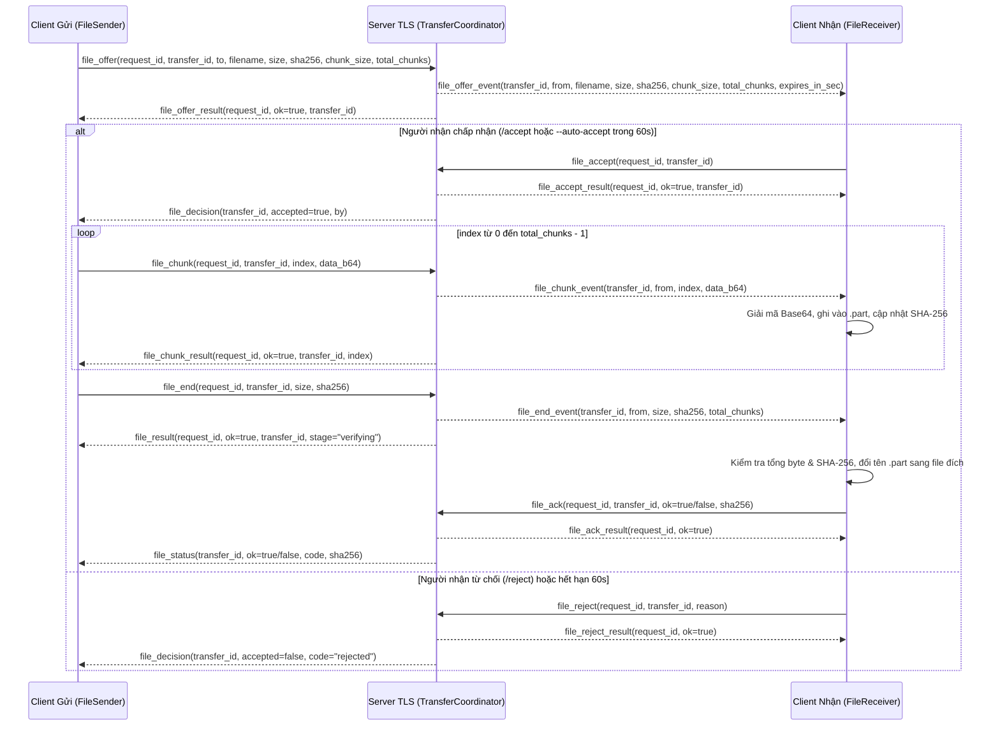
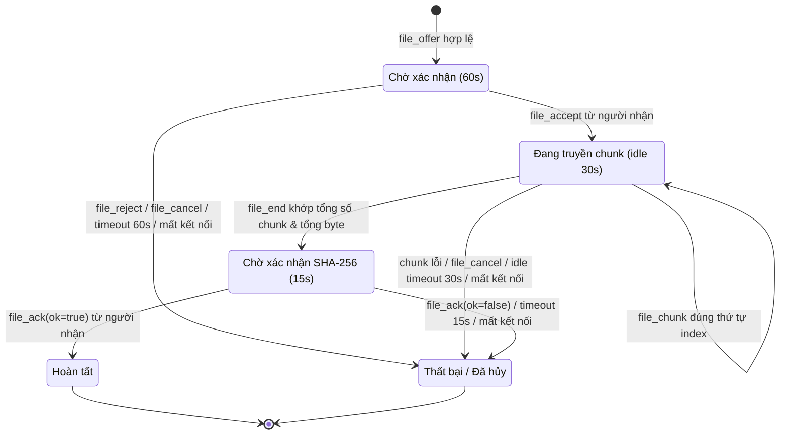

# Kế hoạch Triển khai Phần việc Thành viên 3 & Tích hợp End-to-End

## 1. Mục tiêu & Tổng quan Review Source Code

Bản kế hoạch này rà soát hiện trạng repository trên nhánh `feature/mem3` (sau khi nhánh của Thành viên 1 và Thành viên 2 đã merge) và đề xuất thiết kế + lộ trình triển khai đầy đủ cho **Thành viên 3** theo [TEAM_PLAN.md](../../TEAM_PLAN.md), đồng thời tích hợp đầu-cuối để toàn bộ 10 mốc chấm điểm của đề bài hoạt động trơn tru.

### Kết quả Review Source Code Hiện tại

| Khu vực | File chính | Đánh giá hiện trạng | Vấn đề cần giải quyết (Member 3 + Tích hợp) |
|---|---|---|---|
| **KDF & Mật khẩu** | [crypto.py](../../src/collab/common/crypto.py), [user_store.py](../../src/collab/server/user_store.py) | Đã dùng `hashlib.scrypt` + `hmac.compare_digest` và chống timing attack cơ bản khi không tìm thấy user. | Tham số `n=2^14, r=8, p=1, dklen=32` đang hardcode; bảng SQLite `users` mới lưu `salt` và `password_hash`, **chưa lưu phiên bản/tham số KDF** (`kdf_params`) để hỗ trợ nâng cấp/rehash về sau như yêu cầu ở mục 5 & 6 của `TEAM_PLAN.md`. |
| **Giao thức chung** | [protocol.py](../../src/collab/common/protocol.py), [errors.py](../../src/collab/common/errors.py) | Đã có framing 4-byte (`MAX_FRAME_SIZE = 1 MiB`) và envelope JSON `v=1`. Đã khai báo sẵn `FILE_OFFER`, `FILE_CHUNK`, `FILE_END`, `FILE_RESULT`. | Thiếu các message cho luồng xác nhận (`file_accept`, `file_reject`, `file_cancel`, `file_ack`) và các server push event tới người gửi/người nhận (`file_offer_event`, `file_decision`, `file_chunk_event`, `file_end_event`, `file_status`) để tương thích không-chặn (non-blocking) với `ClientConnection`. |
| **Module Transfer** | [manifest.py](../../src/collab/transfer/manifest.py), [sender.py](../../src/collab/transfer/sender.py), [receiver.py](../../src/collab/transfer/receiver.py) | Chỉ có 1 dòng docstring rỗng. | Cần xây dựng hoàn chỉnh: `TransferManifest`, làm sạch tên tệp chống Path Traversal, chia chunk Base64, ghép tệp tạm `.part`, kiểm tra kích thước & SHA-256 streaming, timeout và dọn dẹp tệp dở dang. |
| **Server Relay** | [server.py](../../src/collab/server/server.py), [router.py](../../src/collab/server/router.py) | Các message file tại dòng 216–221 đang trả lỗi cố định `server_busy`. | Cần bổ sung bộ điều phối trạng thái truyền tệp (`TransferCoordinator`) chuyển tiếp qua kênh TLS hiện có với bộ nhớ `O(1)` (không gom toàn bộ file trên RAM server), tự động dọn dẹp khi peer mất kết nối hoặc quá hạn. |
| **Client CLI** | [commands.py](../../src/collab/client/commands.py), [main.py](../../src/collab/client/main.py) | Lệnh `/file` đang báo chưa hỗ trợ; chưa hiển thị lời mời nhận file hay phần trăm tiến độ. | Tích hợp `/file PATH USER`, `/accept [ID]`, `/reject [ID]`, `/cancel [ID]`, cờ `--download-dir` & `--auto-accept`, hiển thị tiến độ gửi/nhận an toàn luồng với `input("collab> ")`. |
| **Tài liệu & Báo cáo** | [sequence-diagrams.md](../sequence-diagrams.md), [security.md](../security.md), [technical-report.pdf](../report/technical-report.pdf) | Tài liệu hiện ghi file transfer chưa triển khai; `technical-report.pdf` chỉ là placeholder 523 bytes. | Cập nhật đồng bộ toàn bộ `docs/*.md`, `README.md`, `TEAM_PLAN.md`; biên soạn `docs/report/technical-report.md` (đặc biệt phần truyền tệp, bảo mật, thử thách & giải pháp của Member 3) và script chuẩn xuất `docs/report/technical-report.pdf` hỗ trợ đầy đủ tiếng Việt Unicode. |

---

## 2. User Review Required

> [!IMPORTANT]
> **Thiết kế giao thức truyền tệp không gây Deadlock trên `ClientConnection`**
> Trong [connection.py](../../src/collab/client/connection.py), luồng đọc `_receive_loop` gọi trực tiếp callback `on_event(message)`. Nếu bên trong `on_event` gọi ngược lại `connection.request(...)`, luồng đọc sẽ tự chờ chính nó và gây deadlock.
> Do đó, thiết kế tách bạch rõ hai nhóm message:
> 1. **Client Request -> Server Response** (có `request_id` khớp nhau, phản hồi tức thì không chờ người dùng gõ lệnh): `file_offer`/`file_offer_result`, `file_accept`/`file_accept_result`, `file_reject`/`file_reject_result`, `file_chunk`/`file_chunk_result`, `file_end`/`file_result`, `file_ack`/`file_ack_result`, `file_cancel`/`file_cancel_result`.
> 2. **Server Push Event -> Client** (không mang `request_id`, đi vào `on_event`): `file_offer_event`, `file_decision`, `file_chunk_event`, `file_end_event`, `file_status`. Mọi phản hồi tự động từ phía người nhận (như gửi `file_ack` sau khi kiểm tra SHA-256 hoặc `--auto-accept`) được đẩy sang worker thread ngắn hạn thay vì gọi chặn trên `_receive_loop`.

> [!NOTE]
> **Giới hạn dung lượng và kích thước Chunk mặc định**
> - `DEFAULT_CHUNK_SIZE = 65_536` bytes (64 KiB raw -> ~88 KB Base64), nằm gọn dưới giới hạn `MAX_FRAME_SIZE = 1_048_576` bytes (1 MiB) và không làm nghẽn các bản tin `ping`/`chat_message` đi chung kết nối TLS.
> - `MAX_FILE_SIZE = 67_108_864` bytes (64 MiB mặc định, cấu hình được) nhằm chống tấn công làm đầy ổ đĩa người nhận trong môi trường demo.
> - Thư mục lưu tệp mặc định phía client là `downloads/` (đã được loại khỏi Git trong [.gitignore](../../.gitignore)), tệp đang nhận được ghi vào `.<safe_name>.<transfer_id>.part` và chỉ đổi tên nguyên tử (`os.replace`) sang tên thật sau khi kích thước và mã băm SHA-256 khớp 100%.

---

## 3. Thiết kế Kiến trúc & Giao thức Chi tiết

### 3.1 Luồng Tuần tự Truyền tệp Đáng tin cậy qua TCP/TLS



### 3.2 Sơ đồ Trạng thái Phiên Truyền tệp trên Server



---

## 4. Proposed Changes

### Thành phần 1: Mật mã Mật khẩu & Giao thức Chung (`src/collab/common/`)

#### [MODIFY] [errors.py](../../src/collab/common/errors.py)
- Bổ sung ngoại lệ chuyên biệt `TransferError(CollabError)` (kèm thuộc tính `code: str`) cho các lỗi nghiệp vụ truyền tệp (`invalid_filename`, `file_too_large`, `checksum_mismatch`, `chunk_out_of_order`, `transfer_timeout`, ...).

#### [MODIFY] [crypto.py](../../src/collab/common/crypto.py)
- Định nghĩa dataclass bất biến `ScryptParams(version=1, n=16384, r=8, p=1, dklen=32, salt_len=16, maxmem=67108864)` với hàm `to_spec() -> str` (chuỗi chuẩn `"scrypt$v=1$n=16384$r=8$p=1$dklen=32"`) và `from_spec(spec: str) -> ScryptParams` có kiểm tra giới hạn an toàn.
- Giữ nguyên chữ ký tương thích ngược `derive_password(password, salt=None, *, params=DEFAULT_SCRYPT_PARAMS)` và `verify_password(password, salt, expected, *, params=DEFAULT_SCRYPT_PARAMS)` sử dụng `hmac.compare_digest`.
- Bổ sung `needs_rehash(stored_spec: str | None, target: ScryptParams = DEFAULT_SCRYPT_PARAMS) -> bool` để hỗ trợ nâng cấp tham số KDF tự động khi đăng nhập.

#### [MODIFY] [protocol.py](../../src/collab/common/protocol.py)
- Khai báo hằng số truyền tệp: `DEFAULT_CHUNK_SIZE = 65_536`, `MAX_CHUNK_SIZE = 262_144`, `MAX_FILE_SIZE = 67_108_864`, `MAX_FILENAME_LENGTH = 200`.
- Bổ sung các `MessageType` còn thiếu:
  - Requests/Responses: `FILE_ACCEPT`, `FILE_ACCEPT_RESULT`, `FILE_REJECT`, `FILE_REJECT_RESULT`, `FILE_ACK`, `FILE_ACK_RESULT`, `FILE_CANCEL`, `FILE_CANCEL_RESULT`.
  - Server Events: `FILE_OFFER_EVENT`, `FILE_DECISION`, `FILE_CHUNK_EVENT`, `FILE_END_EVENT`, `FILE_STATUS`.
- Cập nhật tập `request_types` trong `validate_message()` cho các request mới.

---

### Thành phần 2: Module Truyền Tệp Cốt lõi của Member 3 (`src/collab/transfer/`)

#### [MODIFY] [__init__.py](../../src/collab/transfer/__init__.py)
- Export public API sạch sẽ cho `TransferManifest`, `sanitize_filename`, `compute_file_sha256`, `FileSender`, `FileReceiver`, `TransferProgress`.

#### [MODIFY] [manifest.py](../../src/collab/transfer/manifest.py)
- Triển khai `sanitize_filename(raw_name: str) -> str`:
  - Chuẩn hóa Unicode NFC, cắt bỏ mọi tiền tố đường dẫn cả kiểu POSIX (`/`) lẫn Windows (`\`, ổ đĩa `C:`).
  - Từ chối tên rỗng, `.`, `..`, ký tự điều khiển ASCII (`< 32`), ký tự cấm trên Windows (`<>:"/\|?*`), tên thiết bị đặc biệt của Windows (`CON`, `PRN`, `AUX`, `NUL`, `COM1..9`, `LPT1..9`) và tên vượt quá `MAX_FILENAME_LENGTH`.
- Triển khai `compute_file_sha256(path: Path) -> tuple[int, str]`: đọc streaming từng khối 64 KiB để tính kích thước thực và chuỗi hex SHA-256 (không nạp toàn bộ file lớn vào RAM).
- Triển khai dataclass `TransferManifest` (`transfer_id`, `filename`, `size`, `sha256`, `chunk_size`, `total_chunks`) kèm `from_file(path, chunk_size)` và `from_offer(payload)` (kiểm tra tính nhất quán toán học giữa `size`, `chunk_size` và `total_chunks`, kiểm tra định dạng hex 64 ký tự của `sha256`).
- Triển khai `resolve_safe_paths(download_dir: Path, transfer_id: str, filename: str) -> tuple[Path, Path]`:
  - Xác minh `resolved.is_relative_to(download_dir.resolve())` để chặn tuyệt đối Path Traversal.
  - Sinh đường dẫn tệp tạm `.<safe_name>.<transfer_id>.part` và hàm chọn đường dẫn đích chống ghi đè (`report.pdf` -> `report (1).pdf` nếu trùng tên).

#### [MODIFY] [sender.py](../../src/collab/transfer/sender.py)
- Triển khai `FileSender`:
  - Quản lý các phiên gửi đang hoạt động theo `transfer_id` (an toàn luồng với `threading.Lock` và `threading.Event` chờ `file_decision` / `file_status`).
  - `start_send(file_path, recipient, *, on_progress, on_complete) -> TransferManifest`: tạo manifest, gửi `file_offer`, khởi chạy worker thread nền chờ người nhận xác nhận (timeout 60s), đọc tuần tự từng chunk mã hóa Base64 gửi qua `file_chunk`, gửi `file_end` (kiểm tra file nguồn không bị thay đổi giữa chừng khi đang đọc!), chờ `file_status` xác nhận SHA-256 từ người nhận (timeout 15s).
  - Hỗ trợ `cancel(transfer_id)` và `abort_all()` khi mất kết nối TLS.

#### [MODIFY] [receiver.py](../../src/collab/transfer/receiver.py)
- Triển khai `FileReceiver`:
  - Quản lý danh sách lời mời đang chờ (`pending_offers`) và các phiên đang ghi chunk (`active_receives`) trong `download_dir`.
  - Hỗ trợ tìm theo tiền tố `transfer_id` (ví dụ 8 ký tự đầu hoặc tự chọn khi chỉ có 1 lời mời đang chờ) để trải nghiệm gõ lệnh `/accept` trên CLI nhanh gọn.
  - Khi nhận `accept(transfer_id)`: mở tệp tạm `.part` trong `download_dir`, gửi `file_accept` lên server.
  - Khi nhận `handle_chunk_event(msg)`: giải mã Base64, kiểm tra đúng thứ tự `index`, kiểm tra không vượt quá `size` đã khai báo, ghi trực tiếp xuống `.part`, cập nhật bộ băm `hashlib.sha256()` tăng dần và gọi callback hiển thị tiến độ (mỗi mốc 25% hoặc chunk cuối).
  - Khi nhận `handle_end_event(msg)`: đóng tệp `.part`, đối chiếu `bytes_received == manifest.size` và `actual_sha256 == manifest.sha256`. Nếu khớp -> `os.replace(part_path, final_path)` nguyên tử và gửi `file_ack(ok=True)` qua worker ngắn hạn; nếu lệch -> xóa ngay `.part` và gửi `file_ack(ok=False, code="checksum_mismatch")`.
  - `cleanup_transfer()`, `reap_expired()` và `abort_all()` đảm bảo đóng file descriptor và xóa sạch mọi file `.part` khi lỗi/timeout/mất kết nối.

---

### Thành phần 3: Nâng cấp Lưu trữ Tài khoản & Điều phối Truyền tệp trên Server (`src/collab/server/`)

#### [MODIFY] [user_store.py](../../src/collab/server/user_store.py)
- Mở rộng bảng `users` lưu thêm cột `kdf_params TEXT NOT NULL` (tự động `ALTER TABLE` nếu mở lại file SQLite cũ chưa có cột này).
- Khi `create_user`: lưu `salt`, `digest`, và `self.kdf_params.to_spec()`.
- Khi `authenticate`: đọc `kdf_params` từ DB để dẫn xuất đúng phiên bản/tham số; nếu xác thực đúng và `needs_rehash(...)` là `True`, tự động tính lại salt + hash theo tham số mới và cập nhật DB.

#### [NEW] `src/collab/server/transfer_coordinator.py`
- Quản lý vòng đời các phiên truyền tệp đang hoạt động trên server (`offered` -> `accepted` -> `verifying`), giới hạn số phiên đồng thời mỗi user (ví dụ tối đa 3 phiên song song/user) để tránh lạm dụng tài nguyên.
- Định tuyến `file_offer`, `file_accept`, `file_reject`, `file_chunk`, `file_end`, `file_ack`, `file_cancel` giữa `sender` và `recipient` qua hàm `send(session, message)` của server mà **không lưu dữ liệu chunk trong bộ nhớ server**.
- Cung cấp `on_disconnect(username)` và `reap_expired()` (gọi định kỳ từ vòng lặp accept của `CollaborationServer`) để thu hồi phiên treo và báo `file_status(ok=False, code="peer_disconnected" | "transfer_timeout")` cho phía còn lại.

#### [MODIFY] [server.py](../../src/collab/server/server.py)
- Khởi tạo `self.transfers = TransferCoordinator(self.sessions, self._send)`.
- Thay khối trả lỗi `server_busy` bằng lời gọi sang `self.transfers.handle_request(session, request)`.
- Gọi `self.transfers.on_disconnect(session.username)` khi `logout` hoặc đóng kết nối trong `_handle_connection`, và gọi `self.transfers.reap_expired()` trong `_reap_idle_sessions()`.

---

### Thành phần 4: Tích hợp Client CLI & Hiển thị Tiến độ (`src/collab/client/`)

#### [MODIFY] [commands.py](../../src/collab/client/commands.py)
- Gắn `FileSender` và `FileReceiver` vào `CommandLine` (cấu hình được `download_dir`, `auto_accept`).
- Cập nhật lệnh CLI:
  - `/file PATH USER`: khởi chạy gửi tệp tới `USER`, in mã ngắn `transfer_id` và trạng thái chờ/tiến độ `%`.
  - `/accept [ID]` và `/reject [ID]`: chấp nhận hoặc từ chối lời mời nhận tệp (nếu chỉ có 1 lời mời đang chờ, có thể gõ `/accept` không cần gõ lại ID).
  - `/cancel [ID]`: hủy phiên truyền đang diễn ra.
  - Cập nhật `/help` và xử lý các event `file_offer_event`, `file_decision`, `file_chunk_event`, `file_end_event`, `file_status`, đồng thời gọi `abort_all()` khi nhận `connection_lost` hoặc thoát CLI.

#### [MODIFY] [main.py](../../src/collab/client/main.py)
- Thêm tùy chọn `--download-dir` (mặc định `downloads` hoặc biến môi trường `COLLAB_DOWNLOAD_DIR`) và `--auto-accept` phục vụ mô phỏng nhiều client/kiểm thử nhanh.

---

### Thành phần 5: Kiểm thử Tự động (`tests/`)

#### [NEW] `tests/unit/test_crypto_and_kdf.py`
- Kiểm thử `ScryptParams` serialize/deserialize, salt ngẫu nhiên khác nhau cho cùng mật khẩu, `verify_password` constant-time, migration bảng SQLite cũ và tự động rehash khi nâng tham số KDF trong `UserStore`.

#### [NEW] `tests/unit/test_transfer_manifest.py`
- Kiểm thử chống Path Traversal (`../../etc/passwd`, `..\..\Windows\win.ini`, `C:\evil.exe`, tên rỗng, `.`, `CON.txt`), file rỗng 0-byte, file nhiều chunk, chống ghi đè tên file trùng và dọn dẹp file `.part`.

#### [NEW] `tests/integration/test_file_transfer_integration.py`
- Kiểm thử tích hợp đầu-cuối qua socket TLS thật (chứng chỉ tự sinh tạm trong test hoặc context TLS thực) và `ClientConnection` + `CollaborationServer`:
  1. Truyền tệp nhị phân lớn nhiều chunk (> 300 KB, dữ liệu ngẫu nhiên) từ Alice sang Bob -> kích thước và SHA-256 khớp tuyệt đối.
  2. Người nhận từ chối (`/reject`) -> người gửi nhận thông báo từ chối ngay.
  3. Lời mời hết hạn timeout -> tự động hủy sạch trạng thái.
  4. Giả lập chunk bị hỏng checksum hoặc ngắt kết nối đột ngột giữa chừng -> file `.part` bị xóa sạch, không xuất hiện file hỏng trong `download_dir`, server vẫn tiếp tục phục vụ các client khác bình thường.
  5. Kiểm thử tải đồng thời 12 client cùng kết nối, chat và truyền file trên localhost.

---

### Thành phần 6: Tài liệu Kỹ thuật & Báo cáo PDF (`docs/`, `README.md`, `TEAM_PLAN.md`)

#### [MODIFY] [sequence-diagrams.md](../sequence-diagrams.md)
- Hoàn thiện sơ đồ tuần tự chính thức cho truyền tệp (luồng thành công, luồng từ chối/timeout, luồng ngắt kết nối/sai checksum và thu dọn `.part`), khớp 100% tên message trong code.

#### [MODIFY] [security.md](../security.md)
- Bổ sung chi tiết định dạng lưu trữ `kdf_params` và cơ chế nâng cấp tham số `scrypt`, chính sách không ghi log bí mật, kiến trúc bảo mật truyền tệp (chỉ đi qua TLS 1.2+, chống Path Traversal, cô lập `.part`, kiểm tra toàn vẹn ứng dụng bằng SHA-256 bổ trợ cho TLS, giới hạn dung lượng chống DoS ổ đĩa) và ranh giới mô hình đe dọa (threat model).

#### [MODIFY] [protocol.md](../protocol.md), [state-diagrams.md](../state-diagrams.md), [architecture.md](../architecture.md), [README.md](../../README.md), [TEAM_PLAN.md](../../TEAM_PLAN.md)
- Cập nhật Mục 6 & Mục 7 của `protocol.md` từ "Chưa triển khai" sang đặc tả đầy đủ tất cả JSON payload truyền tệp và mã lỗi.
- Cập nhật sơ đồ trạng thái truyền tệp trong `state-diagrams.md`, sơ đồ kiến trúc trong `architecture.md`, hướng dẫn dùng `/file`, `/accept`, `/reject` trong `README.md` và cập nhật trạng thái các mốc trong `TEAM_PLAN.md`.

#### [NEW] `docs/report/technical-report.md` & `docs/report/build_report.py`
- Biên soạn báo cáo kỹ thuật đầy đủ bằng tiếng Việt tại `docs/report/technical-report.md`:
  1. Kiến trúc tổng thể Client–Server & Luồng UDP Discovery/Heartbeat.
  2. Thiết kế giao thức ứng dụng trên TCP/TLS & Framing 4-byte.
  3. Thiết kế Truyền tệp Đáng tin cậy (Chunking, Streaming `.part`, SHA-256 End-to-End, Backpressure).
  4. Thiết kế Bảo mật (TLS 1.2+ xác minh chứng chỉ, `scrypt` có phiên bản tham số, chống Path Traversal).
  5. Sơ đồ Trạng thái & Sơ đồ Tuần tự.
  6. **Thử thách Kỹ thuật & Giải pháp (Trọng tâm Member 3)**: giải quyết bài toán ranh giới gói tin TCP, tránh nghẽn bộ nhớ server khi chuyển tiếp file lớn, chống deadlock trên luồng đọc client bất đồng bộ, xử lý tệp dở dang khi đứt mạng và bảo vệ đường dẫn đa nền tảng Windows/Linux.
  7. Kết quả kiểm thử tự động & mô phỏng đa client (10–20 clients).
- Viết script `docs/report/build_report.py` (chỉ dùng Python stdlib + trình duyệt Edge/Chrome headless sẵn có trên máy) để biên dịch `technical-report.md` thành bản in [technical-report.pdf](../report/technical-report.pdf) sắc nét, hiển thị chuẩn tiếng Việt và bảng biểu/sơ đồ (lưu ý đặt tại `docs/report/` vì `scripts/` đang nằm trong `.gitignore`).

---

## 5. Verification Plan

### Automated Tests
Chạy toàn bộ unit tests và integration tests (bao gồm mô phỏng lỗi mạng, chứng chỉ TLS sai/đúng, truyền file nhiều chunk và đồng thời nhiều client):

```powershell
$env:PYTHONPATH = "src"
python -m unittest discover -s tests/unit -v
python -m unittest discover -s tests/integration -v
```

Tạo và kiểm tra file PDF báo cáo kỹ thuật:

```powershell
python docs/report/build_report.py
```

### Manual Verification (Mô phỏng nhiều Terminal theo Rubric)
1. Tạo chứng chỉ demo SAN `localhost, 127.0.0.1` theo hướng dẫn trong `certs/README.md`.
2. **Terminal 1 (Server)**:
   ```powershell
   $env:PYTHONPATH = "src"
   python -m collab.server.main --host 127.0.0.1 --port 37021 --udp-port 37020 --cert certs/server.crt --key certs/server.key
   ```
3. **Terminal 2 (Alice)**:
   ```powershell
   $env:PYTHONPATH = "src"
   python -m collab.client.main --discover --ca certs/server.crt --download-dir downloads/alice
   ```
   Gõ `/register alice` -> `/login alice`.
4. **Terminal 3 (Bob)**:
   ```powershell
   $env:PYTHONPATH = "src"
   python -m collab.client.main --discover --ca certs/server.crt --download-dir downloads/bob
   ```
   Gõ `/register bob` -> `/login bob`.
5. Tại Terminal 2 (Alice), gửi một tệp lớn hơn 64 KB: `/file docs/report/technical-report.pdf bob`.
6. Tại Terminal 3 (Bob), quan sát thông báo lời mời và gõ `/accept`, kiểm tra tiến độ `%` hiển thị ở cả hai phía và đối chiếu mã băm `Get-FileHash` của tệp nhận được trong `downloads/bob/` khớp 100% với tệp gốc.
