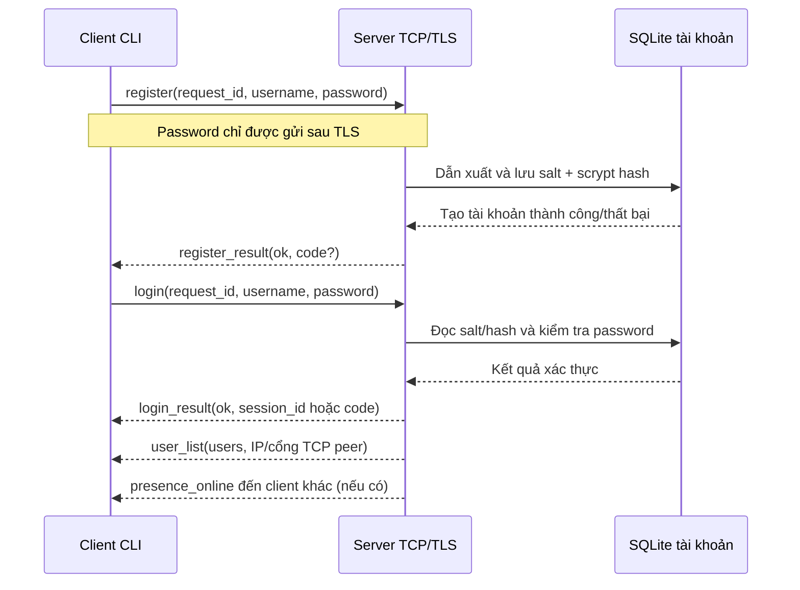
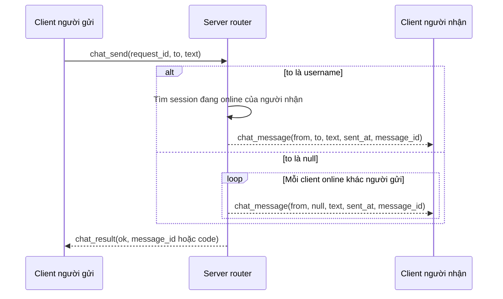
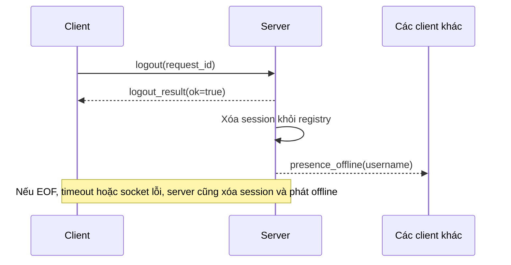
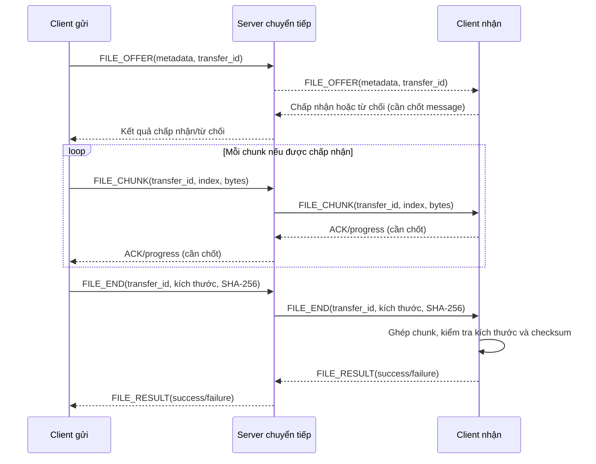

# Sơ đồ tuần tự

Các sơ đồ dưới đây phân biệt luồng đang có trong mã với luồng file chưa triển khai. Tên message giữ nguyên theo protocol để có thể tra trong code.

## Tìm server qua UDP rồi kết nối an toàn

```mermaid
sequenceDiagram
    participant C as Client
    participant U as Server discovery UDP
    participant T as Server TCP/TLS
    C->>U: discover(request_id)
    U-->>C: server_announcement(host, tcp_port)
    Note over C,T: Discovery chỉ trả địa chỉ gợi ý; client vẫn xác minh chứng chỉ TLS
    C->>T: TCP connect
    C->>T: TLS ClientHello
    T-->>C: Chứng chỉ server + TLS handshake
    Note over C: Client xác minh CA và hostname/IP
    C->>T: hello(request_id)
    T-->>C: welcome(request_id)
    loop Theo chu kỳ công bố trong welcome
        C->>T: ping(request_id)
        T-->>C: pong(request_id)
        C->>U: client_heartbeat(client_id)
        U-->>C: heartbeat_ack(client_id, server_id)
    end
    Note over C,U: UDP heartbeat không giữ phiên TCP và không đăng nhập user
```

## Đăng ký và đăng nhập



Đề gốc yêu cầu cơ chế đăng nhập; bước đăng ký và cách lưu tài khoản bằng `scrypt` là thiết kế bổ sung của nhóm.

## Gửi tin nhắn riêng hoặc broadcast



`chat_result.ok=true` nghĩa là server đã định tuyến, không chứng minh người nhận đã đọc. Không có lưu lịch sử hoặc hàng đợi offline.

## Thoát hoặc mất kết nối



## Truyền file

**Chưa triển khai đầu-cuối.** Các module `transfer/` hiện là khung; server trả `error(code=server_busy)` khi nhận `file_offer`, `file_chunk` hoặc `file_end`. Vì chưa có lifecycle đang chạy, tài liệu không mô tả một sequence thành công giả định. Khi tích hợp, cần bổ sung offer/accept/reject, chunk index/offset, checksum, phản hồi tiến độ, hành vi resume/cleanup và cập nhật sơ đồ theo code thực.

Sơ đồ dưới đây là **phác thảo để nhóm hoàn thiện theo yêu cầu đề**, không phải hợp đồng giao thức đã chốt hay tính năng có thể chạy. Tên message/field chỉ minh họa; Member 1–3 phải thống nhất schema trước khi triển khai.



Tất cả message file khi triển khai phải đi trong kết nối TCP/TLS hiện có; không mở kênh UDP hoặc TCP không mã hóa riêng. Tên file phải được xử lý an toàn và nội dung chưa đủ/chưa kiểm checksum không được xem là file hoàn tất.
