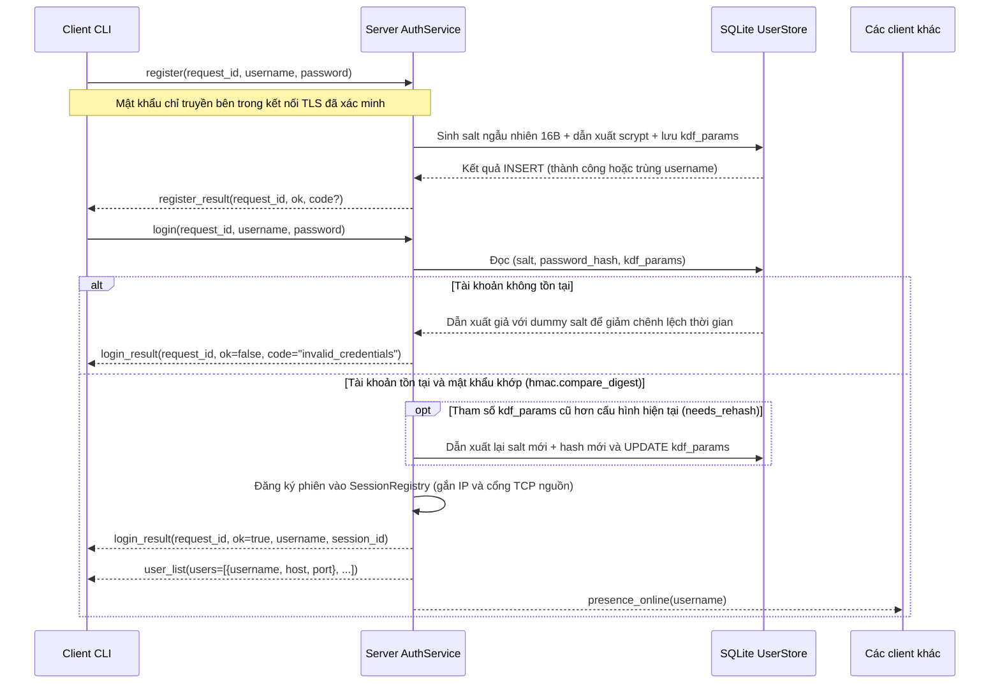
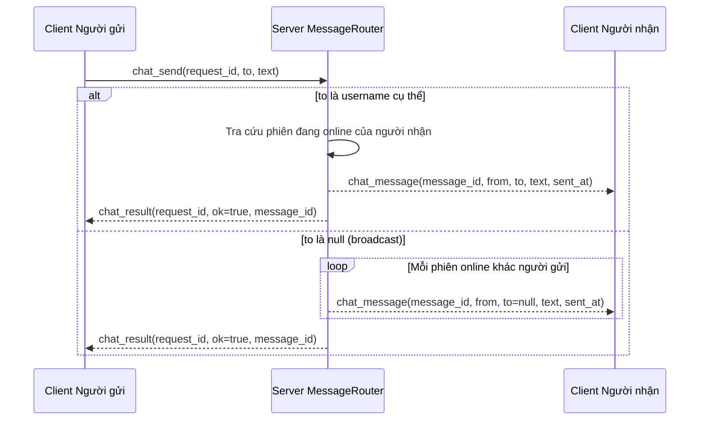
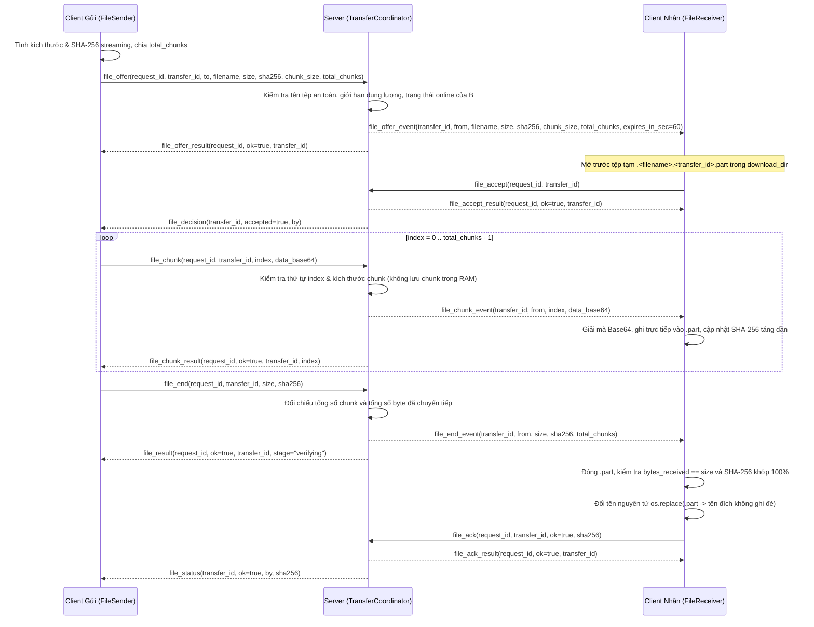
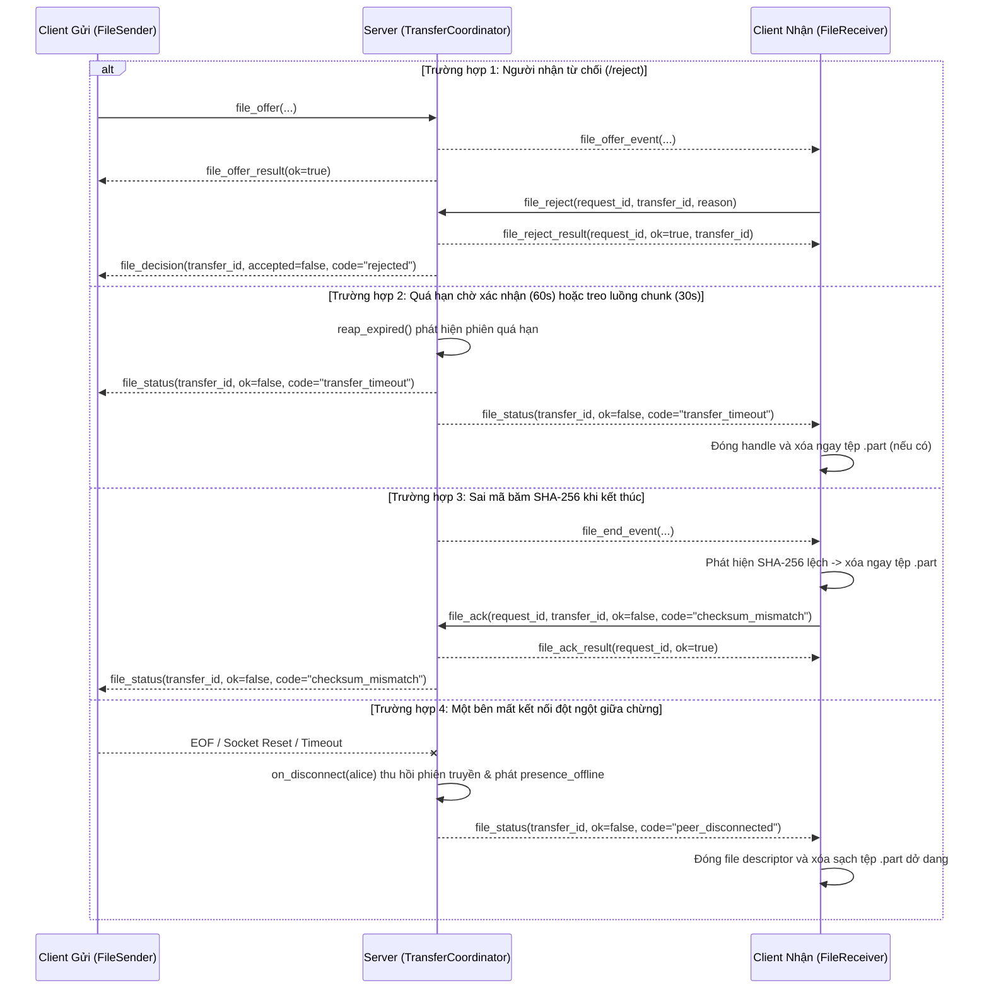
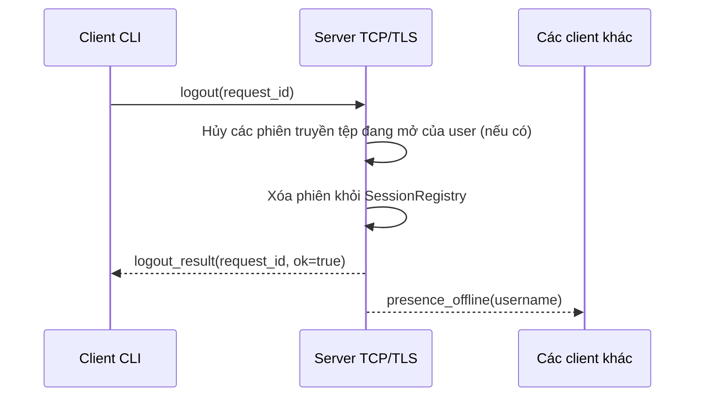

# Sơ đồ tuần tự (Sequence Diagrams)

Tài liệu này mô tả đầy đủ các luồng tương tác tuần tự đã triển khai trong mã nguồn, bao gồm: dò tìm máy chủ qua UDP, thiết lập kênh TCP/TLS, đăng ký/đăng nhập với `scrypt` có phiên bản tham số, nhắn tin broadcast/direct, truyền tệp tin cậy nhiều chunk và cơ chế tự phục hồi khi từ chối, quá hạn hoặc đứt kết nối. Tên bản tin khớp chính xác với `collab.common.protocol.MessageType`.

## 1. Tìm máy chủ qua UDP rồi kết nối TCP/TLS an toàn

```mermaid
sequenceDiagram
    participant C as Client CLI
    participant U as Server Discovery UDP
    participant T as Server TCP/TLS

    C->>U: discover(request_id)
    U-->>C: server_announcement(request_id, server_id, server_name, host, tcp_port)
    Note over C,T: Địa chỉ UDP chỉ là gợi ý; danh tính máy chủ phải được xác minh ở bước TLS
    C->>T: TCP connect
    C->>T: TLS Handshake (TLS 1.2+ / TLS 1.3)
    T-->>C: Chứng chỉ X.509 của Server
    Note over C: Xác minh chuỗi tin cậy CA và khớp SAN (hostname/IP)
    C->>T: hello(request_id, client, client_version)
    T-->>C: welcome(request_id, protocol_version=1, heartbeat_interval_sec=30)
    Note over C: Bắt tay ứng dụng hoàn tất trước khi mở luồng đọc nền để tránh xung đột TLS 1.3 NewSessionTicket

    loop Định kỳ theo heartbeat_interval_sec
        C->>T: ping(request_id)
        T-->>C: pong(request_id)
        C->>U: client_heartbeat(client_id)
        U-->>C: heartbeat_ack(client_id, server_id)
    end
```

## 2. Đăng ký, Đăng nhập và Nâng cấp tham số KDF `scrypt`



## 3. Gửi tin nhắn riêng (Direct) và Broadcast



## 4. Truyền tệp Đáng tin cậy qua TCP/TLS (Luồng Thành công)

Toàn bộ luồng điều khiển và dữ liệu tệp đi qua kết nối TCP/TLS hiện có. Các request có `request_id` được phản hồi tức thì để không chặn luồng đọc nền `_receive_loop` trên client; các bản tin chuyển tiếp dùng server push event bất đồng bộ.



## 5. Truyền tệp: Từ chối, Quá hạn (Timeout) và Phục hồi khi Lỗi / Đứt kết nối



## 6. Đăng xuất chủ động


