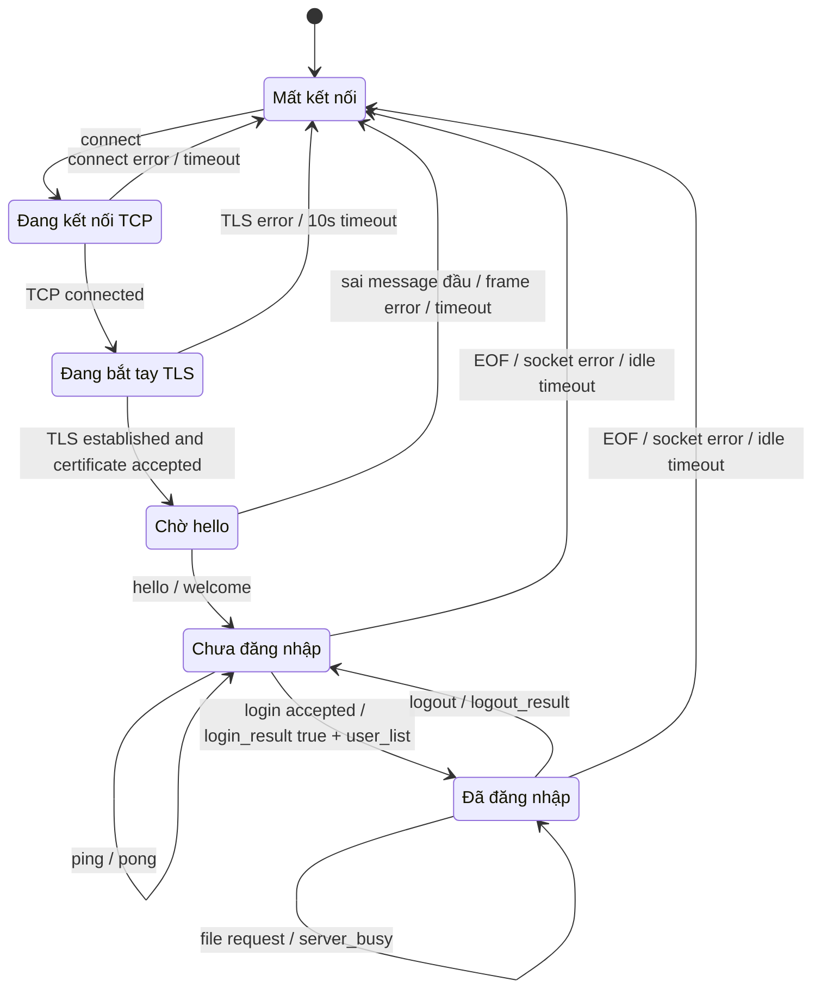
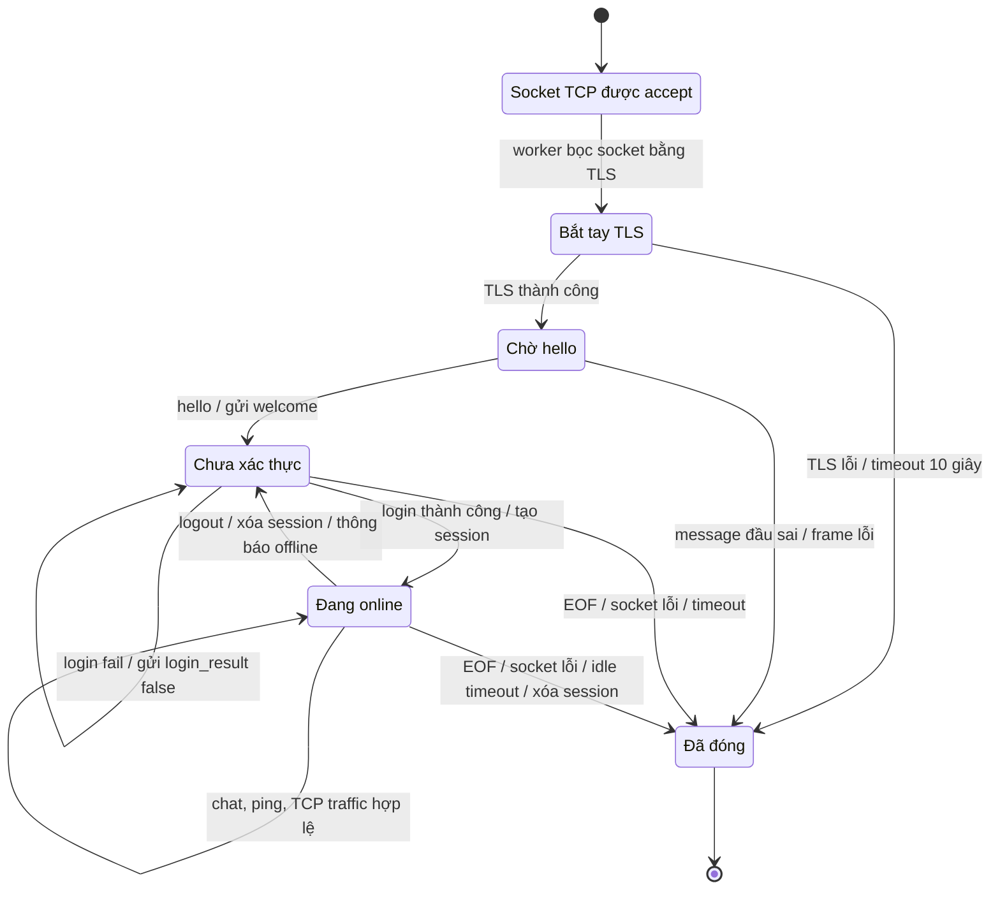

# Sơ đồ trạng thái

Các sơ đồ dưới đây mô tả trạng thái TCP/TLS và UDP đang có trong mã. Tên message trong code được giữ nguyên để dễ tìm kiếm. File transfer chưa có trạng thái hoạt động.

## Client TCP/TLS và đăng nhập

## Session phía server

`Online` tương ứng entry trong session registry, chỉ tạo sau khi đăng nhập thành công. Server xóa entry trước khi báo `presence_offline`, nên logout sau đó đóng socket không phát offline hai lần. Idle timeout mặc định 90 giây; client gửi TCP `ping` định kỳ. UDP heartbeat không làm thay đổi trạng thái session.

## Discovery UDP (độc lập với session TCP)

```mermaid
stateDiagram-v2
    [*] --> ChuaTimThay
    state "Chưa tìm thấy server" as ChuaTimThay
    state "Đã nhận địa chỉ gợi ý" as DaTimThay
    state "Đang dùng TCP/TLS" as DangKetNoi
    ChuaTimThay --> DaTimThay: discover / server_announcement
    ChuaTimThay --> ChuaTimThay: timeout hoặc broadcast bị chặn
    DaTimThay --> DangKetNoi: TCP connect rồi xác minh TLS
    DangKetNoi --> DaTimThay: kết nối lỗi; địa chỉ vẫn chỉ là gợi ý
```

Client cũng gửi `client_heartbeat` và server trả `heartbeat_ack`; server không gắn `client_id` với tài khoản và không dùng datagram này để giữ user online.

## File request hiện tại

```mermaid
stateDiagram-v2
    [*] --> Authenticated
    state "Đã đăng nhập" as Authenticated
    Authenticated --> Authenticated: file_offer / file_chunk / file_end
    note right of Authenticated: server trả error code server_busy; không tạo transfer state
```

