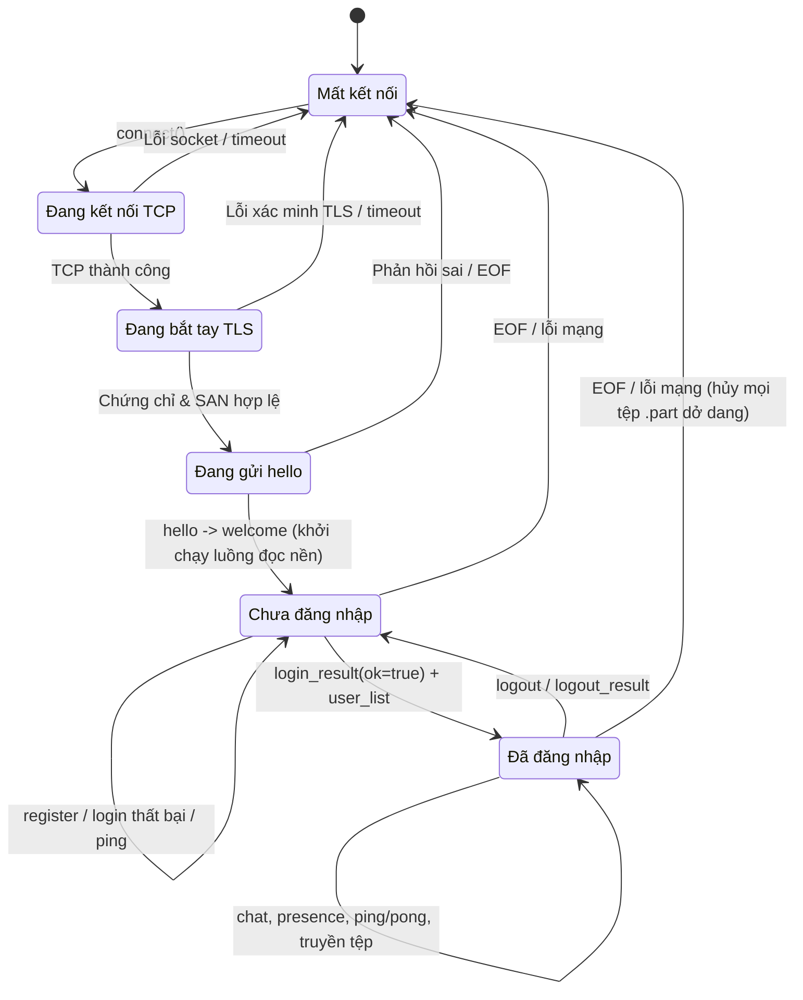
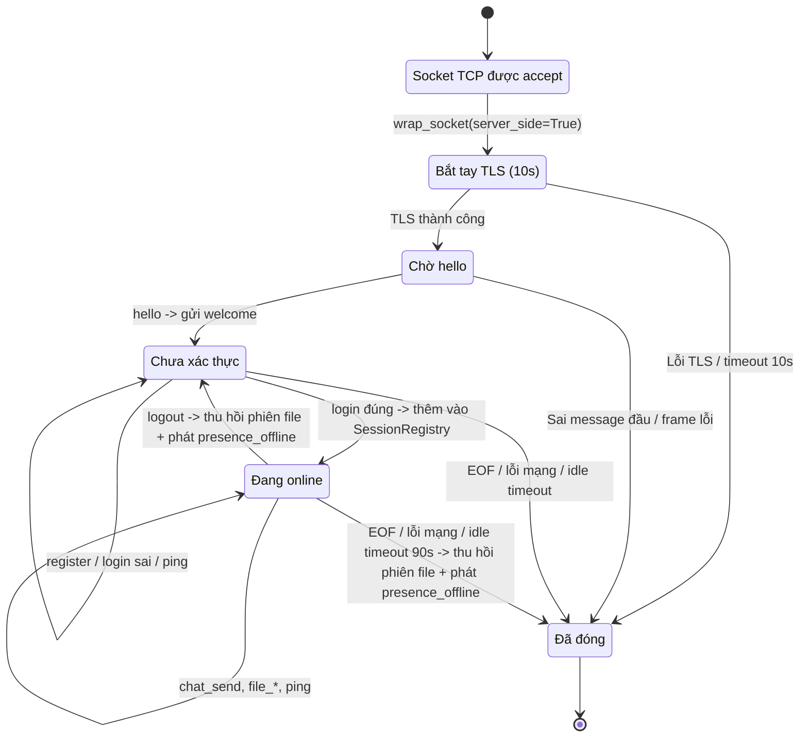
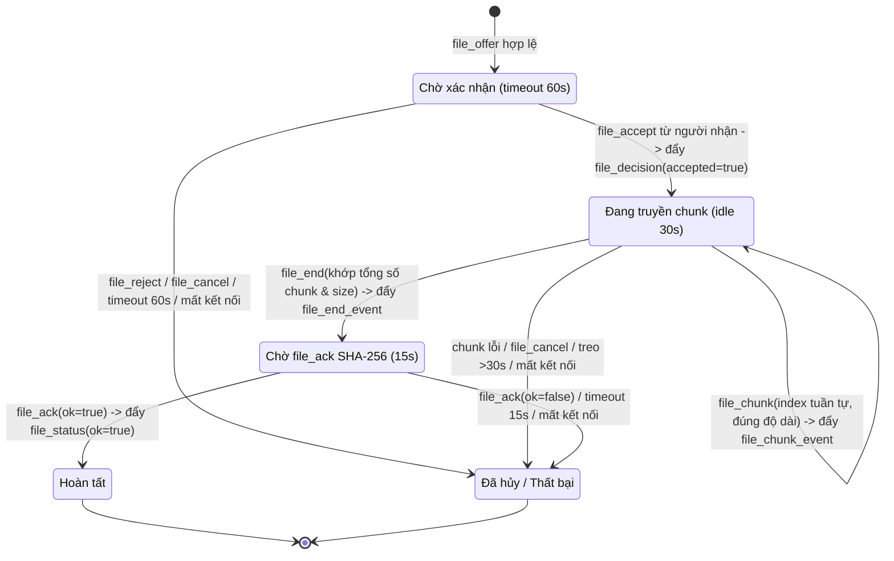
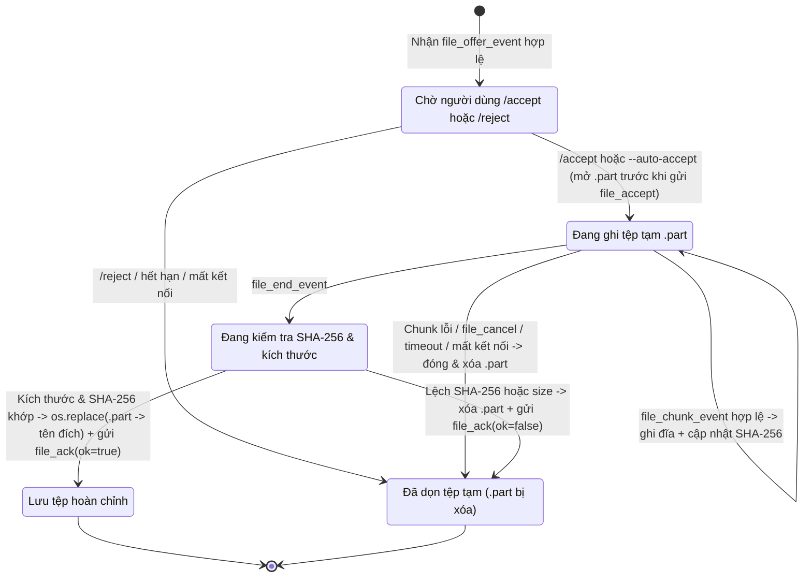

# Sơ đồ trạng thái (State Diagrams)

Các sơ đồ dưới đây mô tả máy trạng thái của kết nối Client TCP/TLS, Session phía Server, UDP Discovery và vòng đời Phiên Truyền tệp (`TransferCoordinator`, `FileSender`, `FileReceiver`) khớp trực tiếp với mã nguồn.

## 1. Kết nối Client TCP/TLS và Xác thực

## 2. Session phía Server

## 3. Vòng đời Phiên Truyền tệp trên Server (`TransferCoordinator`)

## 4. Vòng đời Nhận tệp phía Client (`FileReceiver`)

## 5. Discovery UDP (Độc lập với Session TCP)

```mermaid
stateDiagram-v2
    [*] --> ChuaTimThay
    state "Chưa tìm thấy server" as ChuaTimThay
    state "Đã nhận địa chỉ gợi ý" as DaTimThay
    state "Đang kết nối TCP/TLS" as DangKetNoi

    ChuaTimThay --> DaTimThay: discover / server_announcement
    ChuaTimThay --> ChuaTimThay: Timeout hoặc broadcast bị chặn
    DaTimThay --> DangKetNoi: Mở kết nối TCP và xác minh chứng chỉ TLS
    DangKetNoi --> DaTimThay: Kết nối lỗi; địa chỉ UDP vẫn chỉ là gợi ý
```

