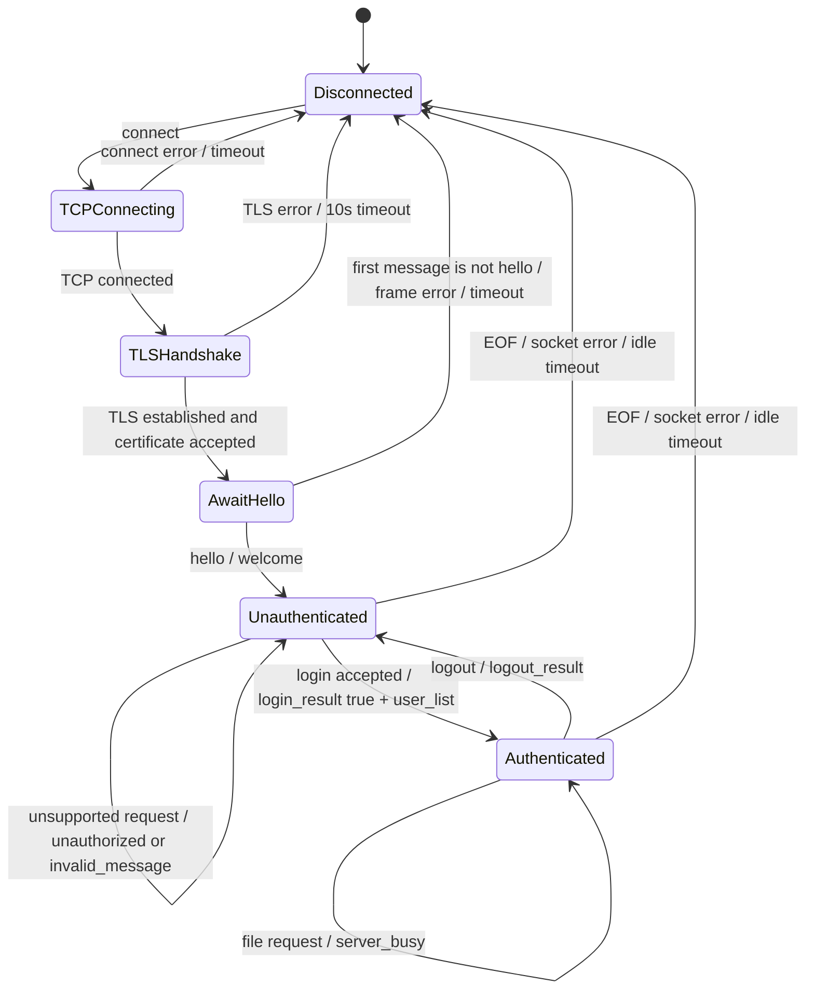
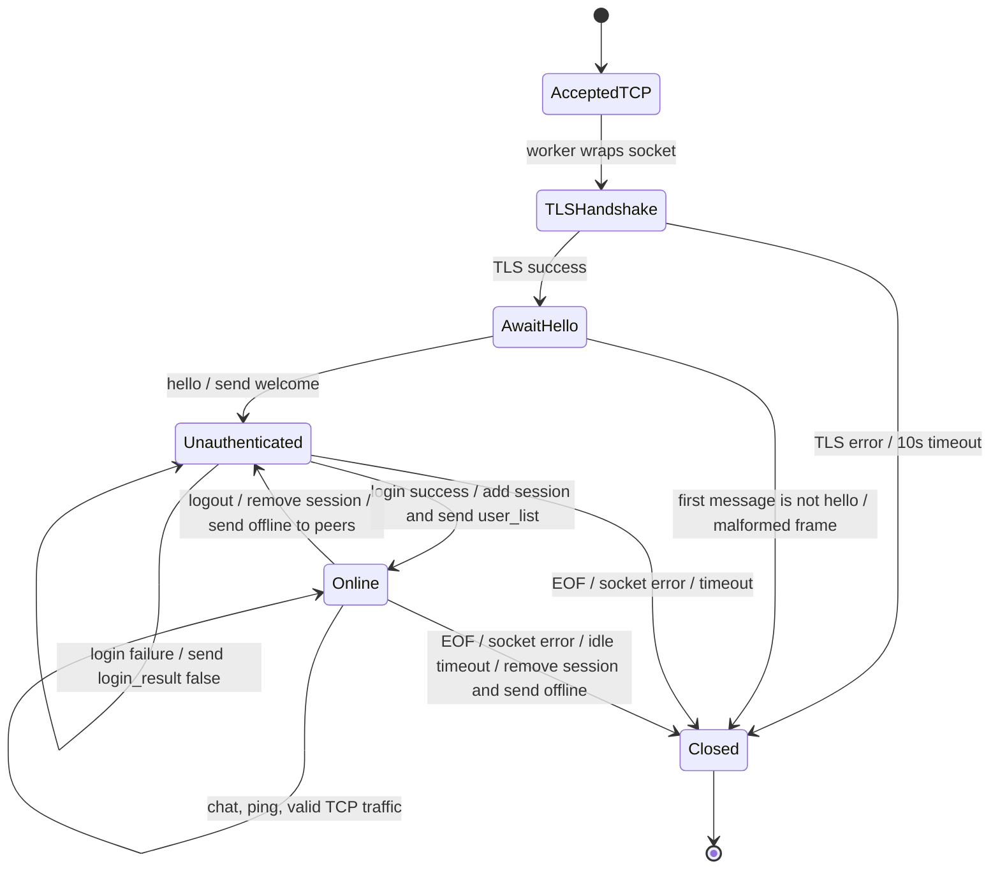
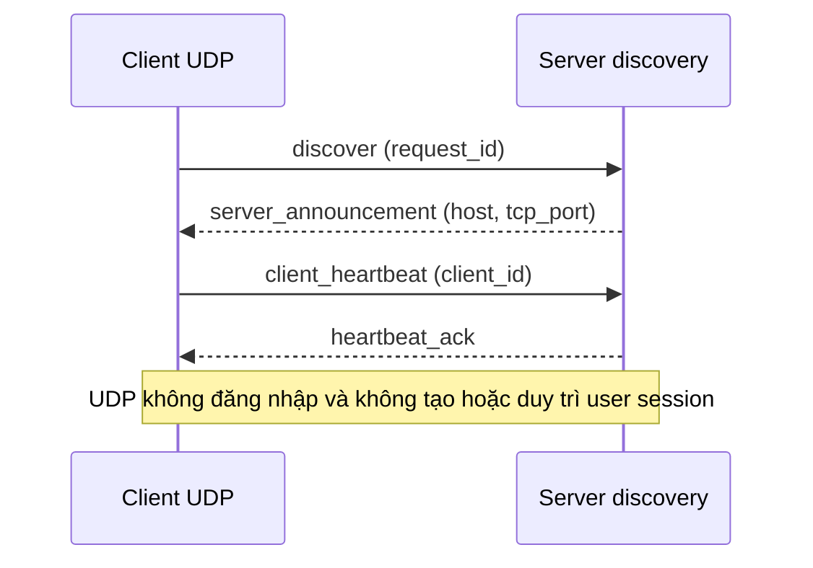

# Sơ đồ trạng thái đang được hiện thực

Các sơ đồ mô tả behavior hiện tại của server theo [`protocol.md`](protocol.md). File transfer chưa có lifecycle hoạt động; các request file hiện nhận `server_busy`.

## Client TCP/TLS và xác thực

Lỗi envelope/framing đóng kết nối. Lỗi ở payload nghiệp vụ có thể trả `error` nhưng giữ kết nối mở. Một `login_result` thành công được theo sau bởi `user_list`; các event presence có thể đến sau đó.

## Server session

`Online` là entry trong registry server, chỉ được tạo sau login thành công. Cleanup xóa entry trước khi phát `presence_offline`, nên logout rồi đóng socket không phát offline lần hai. Idle timeout mặc định là 90 giây. UDP heartbeat không làm thay đổi trạng thái session.

## UDP discovery (độc lập với session TCP)

## File request hiện tại

